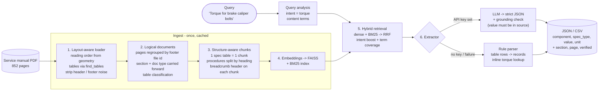

# Service Manual Spec Extractor

Extracts structured vehicle specifications (torque values, fluid capacities, fluid specs, part numbers, limits) from an
automotive service-manual PDF using **retrieval + an LLM**, and returns JSON or CSV with the source page for every value.

Built and tuned on the provided *Ford F-150 2013-2014 workshop manual* (852 pages: suspension, driveline, brakes).

```text
$ python -m specx query "Torque for brake caliper bolts" --minimal
[
  {"component": "Brake caliper anchor plate bolts", "spec_type": "Torque", "value": "250", "unit": "Nm"},
  {"component": "Brake caliper flow bolt",          "spec_type": "Torque", "value": "35",  "unit": "Nm"},
  {"component": "Brake caliper guide pin bolts",    "spec_type": "Torque", "value": "37",  "unit": "Nm"},
  {"component": "Brake caliper guide pin bolts",    "spec_type": "Torque", "value": "33",  "unit": "Nm"},
  {"component": "Brake caliper support bracket bolts", "spec_type": "Torque", "value": "150", "unit": "Nm"}
]
```
(The first three are the front caliper, section 206-03 p.636; the last two the rear caliper, 206-04 p.652. The full output
also carries `alt_values` (lb-ft), `section`, `page`, `verified` and `evidence` - see [Output format](#output-format).)

---

## Architecture



## What is special about this PDF (and what the code does about it)

The manual is a **browser print-out of an HTML workshop manual**. Inspecting it showed a handful of quirks that make naive
"extract text, chunk every 500 tokens, embed" pipelines fail. Each design decision below answers one of them.

| Observation | Consequence for naive extraction | What this project does |
|---|---|---|
| Text stream is **not in reading order** (page header emitted last, steps interleaved with figure callouts) | Garbled context for the LLM | Rebuild reading order from line geometry (`pdf_loader._group_rows`) |
| Spec tables come out **one cell per line**; torque tables use `Nm / lb-ft / lb-in` columns with `—` for "not given" (`18 — 159`) | Values attach to the wrong unit | Detect tables with PyMuPDF, map columns **by header**, treat `—` as empty |
| Every page has print noise: `Page 1 sur 2`, `file:///C:/TSO/...`, watermark, dates | Pollutes every chunk and embedding | Parse it for metadata, then strip it (`config.NOISE_LINE_PATTERNS`) |
| The `SECTION 206-03: Front Disc Brake` header exists **only on the first page** of each printed document (675 of 852 pages have none) | Continuation pages don't know their section | Regroup pages by the footer **file id** (`SE263001.HTM`) into 177 logical documents and carry section / doc-type forward |
| Tables **continue on the next page without a header** (pp. 342, 450) | Rows lose their unit columns | Inherit the previous torque table's header when the first row looks like a torque row |
| Item cells mix **name + Motorcraft part code**, spec cells wrap codes across lines (`WSS-M6C65-` / `A1`) | Broken part numbers | Re-join hyphen-wrapped cells; split name from code with a part-code regex |
| Torque statements in procedures often **don't name the fastener** ("To install, tighten to 35 Nm") - the name is in a figure | The LLM / parser can't say *which* bolt | Retrieval returns the spec table *and* the procedure; the rule parser looks up the unique torque-table row with the same Nm value in the same section; the LLM prompt asks for the same reconciliation |
| Dense embeddings blur exact codes (`XY-75W140-QL`, `WSS-M6C62-A`) | Misses part numbers | **Hybrid** retrieval - BM25 keeps hyphenated codes as tokens |
| The same fact is printed on many pages (brake fluid spec: 9 pages) | Duplicate results | Merge identical facts, keep the others in `also_found_in` |
| Some warning headlines are **baked into images** | Missing text | Out of scope (text-only); OCR fallback exists for pages without a text layer - see [Limitations](#limitations) |

## Quick start

```bash
python -m venv .venv && source .venv/bin/activate
pip install -r requirements.txt
cp /path/to/your-manual.pdf data/service-manual.pdf        # or set SPECX_PDF

python -m specx ingest                                      # ~45 s parse + embed, cached in .specx_cache/
python -m specx query "Torque for brake caliper bolts"      # JSON
python -m specx query "Brake fluid capacity" --format csv
```

**No API key? No model download?** It still runs:

```bash
SPECX_EMBED_BACKEND=tfidf SPECX_LLM_PROVIDER=none python -m specx query "Torque for brake caliper bolts"
```

With an LLM, set one key (or point at Ollama/Groq) - see [`.env.example`](.env.example):

```bash
export ANTHROPIC_API_KEY=...    # or OPENAI_API_KEY=...
python -m specx query "Torque for brake caliper bolts" --mode llm
```

### Other entry points

| | |
|---|---|
| `python -m specx batch examples/sample_queries.txt -o results.csv` | many questions into one CSV / JSON |
| `python -m specx query "..." --trace` | JSON including retrieved chunks, ranks, scores |
| `python -m specx query "..." --strict` | drop any record whose value was not found in the source text |
| `python -m specx inspect 636` | show how one page was parsed (headings, tables, text) |
| `python -m specx eval` | score against `eval/gold.json` |
| `streamlit run app.py` | **UI**: results table, CSV/JSON download, and the PDF page with the value highlighted |
| `notebooks/walkthrough.ipynb` | step-by-step notebook of every stage with outputs |

```python
from specx.pipeline import Pipeline
pipe = Pipeline(); pipe.ensure_ready()
res = pipe.query("Brake fluid capacity")
print(res.to_json()); print(res.to_csv())
```

## Output format

The first four fields are exactly the format in the assignment; the rest provide provenance and quality signals.

```json
{
  "component": "Brake caliper guide pin bolts",
  "spec_type": "Torque",
  "value": "37",
  "unit": "Nm",
  "alt_values": [{"value": "27", "unit": "lb-ft"}],
  "condition": null,
  "notes": null,
  "section": "206-03 Front Disc Brake",
  "page": 636,
  "source": "table",
  "verified": true,
  "evidence": "Brake caliper guide pin bolts | 37 | 27 | —",
  "also_found_in": []
}
```

* `spec_type` is one of `Torque`, `Fluid Capacity`, `Fluid Specification` (e.g. `WSS-M6C62-A`), `Part Number`, `Specification` (limits, clearances, preloads).
* `value` is a string; ranges stay ranges (`"1.5-3.0"`); thousands separators are removed (`"1420"`).
* The primary unit is Nm for torque; other units go to `alt_values`. Rows that say "refer to the procedure" return `value: null` with an explanation in `notes` - the system does not guess.
* `condition` holds variants (`SVT Raptor`, `4WD` ...). `source` is `table`, `text` (procedure sentence) or `llm`.
* `verified` = the value was found verbatim in the cited source text (see grounding below). Examples: [`examples/`](examples).

## Design notes

### Chunking (`chunker.py`)
Fixed-size windows would cut torque tables in half and blend unrelated components. Chunks follow the manual's structure instead:
one chunk per **spec table** (long tables split by row group with the header repeated), and procedure text split at
component / phase headings (`Brake Disc > Removal`), size-capped at ~260 words so chunks stay under the embedding model's token limit.
Every chunk is prefixed with a breadcrumb:

```
[206-03 Front Disc Brake | Specifications | Torque Specifications (Nm, lb-ft, lb-in) | p.636]
| Description | Nm | lb-ft | lb-in |
| Brake caliper guide pin bolts | 37 | 27 | — |
```

The breadcrumb is embedded with the text, so "front brake caliper bolts" finds this table even though the table never says "front".
Result: 836 chunks (19 torque, 54 material, 10 general-spec, 67 part-number tables; the rest procedure / diagnostic text).

### Retrieval (`retriever.py`)
`dense (FAISS, BGE-small by default) + sparse (BM25)` fused with **Reciprocal Rank Fusion**, then multiplicative boosts:
chunk type matching the query intent (a torque question favours torque tables), `SPECIFICATIONS` documents, and a lexical
*term-coverage* factor (a chunk mentioning every content word beats one mentioning some). Query intent comes from simple patterns
(`query.py`): torque / capacity / part number / fluid spec / other.

### Extraction and grounding (`extractor.py`, `rule_parser.py`)
* **LLM path** - the prompt carries the retrieved excerpts as `[C1]..[Ck]` and demands strict JSON. Rules in the prompt: use only
  values in the excerpts, never convert units, keep variants separate, return `null` for "see procedure", reconcile unnamed
  procedure torques with the section's torque table. Output is validated with Pydantic, de-duplicated, and **grounded**:
  the value must occur in the cited excerpt (numbers matched on token boundaries so `99` is not "found" in `p.599`). Ungrounded
  records are kept but flagged `verified: false` - or dropped with `--strict`.
* **Rule path** - a deterministic parser for the four table families plus inline torque sentences. It is the **offline mode**,
  the evaluation **baseline**, and the fallback if the LLM call fails. Relevance filtering uses stemmed term overlap and rejects
  opposite positions (a "lower ball joint nut" query will not return the *upper* one).

### Why both paths?
Tables are regular enough that deterministic parsing is very accurate, so it doubles as an oracle to sanity-check the LLM. The
LLM earns its place on what rules can't do well: free-text specs, unnamed fasteners in procedures, ranking relevance for
loosely worded questions ("how much oil does the rear axle take?"), and merging scattered information.

## Evaluation

`eval/gold.json`: 21 queries / 26 expected values read directly from the PDF text, plus one negative query (spark plugs: not in this manual - must return nothing).

| Metric | Result |
|---|---|
| Retrieval hit-rate (gold page inside the retrieved chunks) | 26 / 26 |
| Extraction recall | 26 / 26 |
| Negative queries correctly empty | 1 / 1 |
| Avg records returned per query | 2.8 |

**Read these numbers with care.** They were measured in *rules mode with the offline TF-IDF embedder* (no model download, no LLM
call - the environment the project was built in), on a small gold set that I also used while developing. They show the
parsing / chunking / retrieval stack works on this manual; they are not a benchmark. Run `python -m specx eval --mode llm` with your
own key and embedding model to measure the LLM path, and extend `gold.json` - it is the intended way to compare embedding
models, `top_k`, or prompts.

## Limitations

* **Text only, by design.** Text embedded in images (some WARNING headlines, figure callouts, wiring diagrams) is not extracted.
  `ocr_fallback` OCRs whole pages that have *no* text layer (needs `tesseract`), but this manual has none.
* **Layout knowledge is specific** to this print format (page header/footer zones, `SECTION` header, footer file ids). Another manual
  needs the constants in `config.py` revisited; the structure-aware approach carries over.
* Rule-based relevance is lexical: a query like "front brake disc minimum thickness" also returns the brake *pad* thickness from the same
  section. The LLM path filters this better.
* The LLM path was **not run end-to-end against a live API** while building this (no key in the build environment). It is tested with
  a mock client (valid JSON, fenced JSON, retry after bad JSON, hallucinated value flagged, fallback to rules on failure).
* Vehicle variants (RWD vs 4WD, engine, axle size) are captured when the *table* says so (`condition`), not inferred from the query.

## Ideas for improvement

1. **Cross-encoder reranker** (e.g. `bge-reranker-base`) over the top-30 fused candidates before extraction.
2. **LLM query rewriting / multi-query** - expand "caliper bolts" into guide-pin / anchor-plate / flow-bolt variants.
3. **Vision / OCR on figures** for callout text and image-only warnings; use page images for tables that fail detection.
4. **Variant-aware queries** - detect "4WD", "SVT Raptor", "3.5L" in the question and filter on `condition`.
5. **Unit normalisation & validation** - cross-check Nm vs lb-ft pairs (1 lb-ft = 1.3558 Nm) to catch OCR/LLM digit errors.
6. **Knowledge-graph / SQL store** of all table records (component, section, value) for exact lookup with RAG only as a fallback.
7. **Larger gold set + CI** to compare embedding models, chunk sizes and prompts; track LLM cost / latency per query.
8. **Index-time extraction** - run the extractor once over every spec table and store records, so queries become retrieval over structured data.

## Project layout

```
specx/
  config.py        settings + manual-specific layout constants
  pdf_loader.py    layout-aware parsing, logical documents, table classification
  cleaning.py      text normalisation (bullets, wrapped codes, stemming)
  units.py         "32 mm (1.259 in)" -> quantities
  chunker.py       structure-aware chunking with breadcrumbs
  embeddings.py    sentence-transformers | openai | tfidf backends
  retriever.py     FAISS + BM25 + RRF + boosts
  query.py         intent detection, term overlap, position-conflict filter
  rule_parser.py   deterministic table / inline-torque extraction
  llm.py           Anthropic, OpenAI(-compatible) clients
  extractor.py     prompt, JSON validation, grounding
  pipeline.py      build / cache / query orchestration
  evaluate.py      gold-set scoring        cli.py  command line        render.py  PDF page highlight
app.py             Streamlit UI
notebooks/         walkthrough.ipynb (executed, with outputs)
eval/gold.json     expected values read from the PDF
examples/          sample queries and outputs
tests/             42 tests (units, parsers, chunker, retrieval, grounding, + PDF integration)
```

Run the tests with `pytest -q` (the PDF integration tests are skipped if the PDF is absent).
